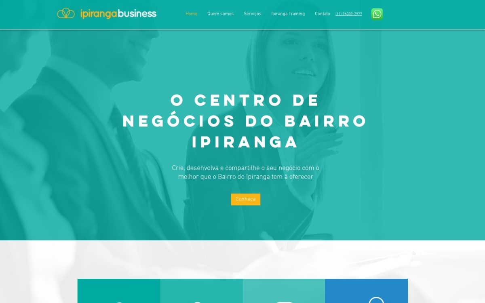
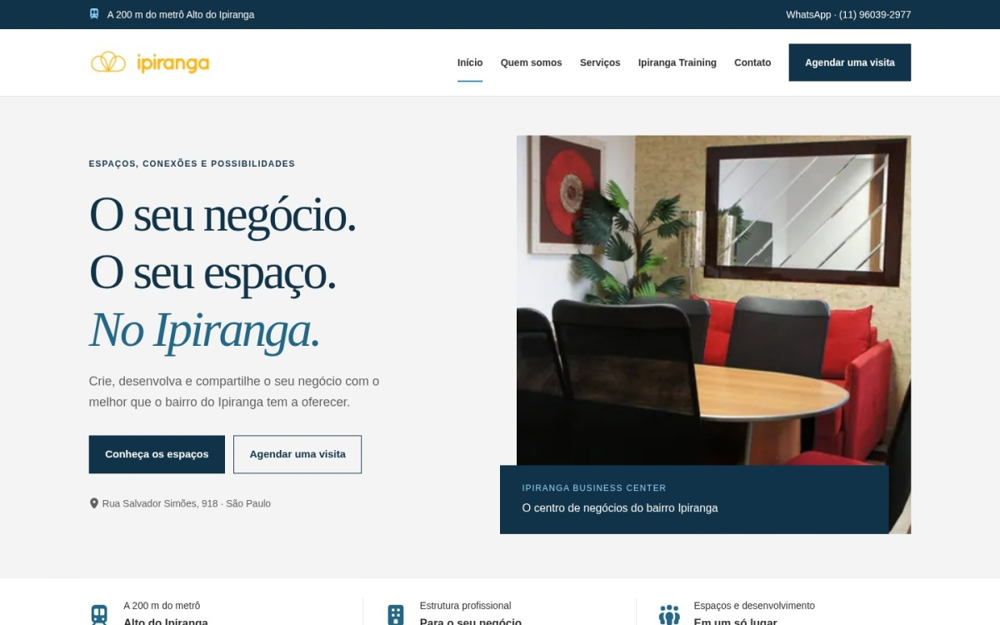
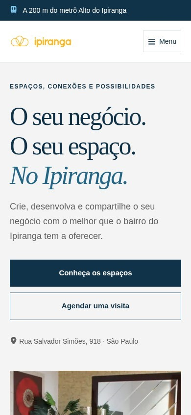
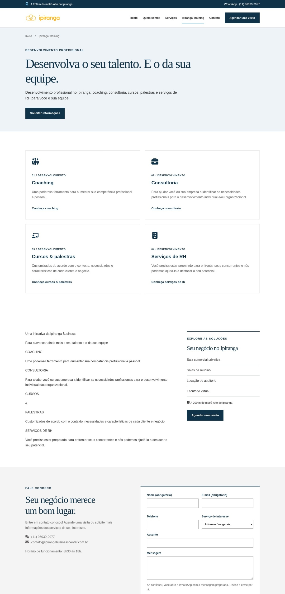
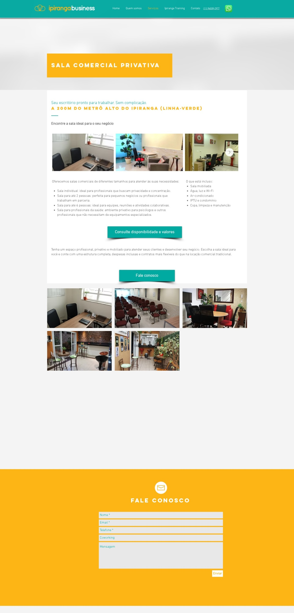
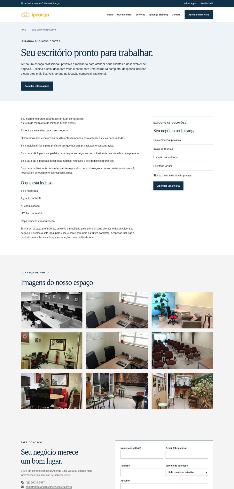
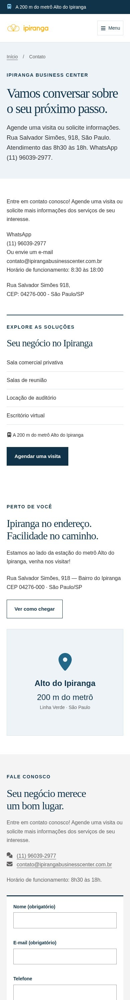

# Comparativo: site antigo e nova versão

**Data:** 10/11/2026. Coleta HTTP iniciada às 17h35 UTC (14h35 de Brasília).  
**Antigo:** [Ipiranga Business Center](https://www.ipirangabusinesscenter.com.br/).  
**Novo publicado:** [GitHub Pages](https://gabrielcano-git.github.io/ipirangabusinesscenter.com.br/).  
**Baseline:** [auditoria de 10/11/2026](../../auditorias/2026-11-10/relatorio-auditoria-2026-11-10.md) e [tentativa anterior de PageSpeed](../../auditorias/2026-11-10/relatorio-pagespeed-2026-11-10.md).  
**Escopo:** 16 rotas em cada site; HTML publicado, metadados, conteúdo, campos, destinos e capturas de três jornadas. Nenhum formulário foi enviado. Nenhum site foi alterado nesta comparação.

## Parecer

A nova versão apresenta avanços verificáveis na identificação das páginas, nos rótulos dos formulários, na apresentação dos espaços e no volume do HTML. A abertura agora mostra uma fotografia do próprio ambiente, diferencia “Conheça os espaços” de “Agendar uma visita” e explicita localização e proximidade do metrô. Nas capturas estreitas, a nova composição adapta título, botões e menu à largura disponível.

A versão publicada serve para validar a direção visual com o cliente. Ainda exige ajustes antes de substituir o site principal: logotipo com parte branca invisível, imagem de compartilhamento quebrada, repetição de conteúdo, confirmação da capacidade do auditório e decisão sobre o contato exclusivo pelo fluxo de WhatsApp. Não há resultado de desempenho nem validação interativa suficientes para declarar a nova versão pronta para produção ou aprovada nos Core Web Vitals.

## Condições e limites da comparação

- Baseline original: nove páginas analisadas por HTML; screenshots, Playwright e PageSpeed não haviam sido concluídos. Nesta rodada, o inventário foi ampliado para 16 páginas por versão.
- O site antigo continua acessível. Quinze HTMLs atuais são idênticos, byte a byte, aos arquivos preservados. O HTML de Contato difere; isso sozinho não comprova mudança de conteúdo comercial. Evidência: [comparação dos arquivos](evidencias/baseline-comparada.json).
- Playwright/Chromium foi tentado novamente, mas falhou antes da navegação com erro MachPort/Permission denied. O navegador integrado também está indisponível. Portanto, não foram executados testes de menu, âncoras, foco, teclado, envio ou árvore de acessibilidade. [Bloqueio](evidencias/browser-limitations.txt).
- Capturas reais foram obtidas pelo serviço remoto WordPress mShots: home a 1440 × 900 e 390 × 844; Training e Sala privativa a 1440 × 3000; Contato a 390 × 3000. As imagens altas são viewports estendidos, não capturas full-page por rolagem. Desktop é reduzido para 1200 px de largura pelo serviço; imagens estreitas mantêm 390 px.
- O serviço de captura não informou user-agent, emulação de telefone, hardware ou momento exato de renderização. As capturas a 390 px representam **uma viewport estreita**, não comprovam o comportamento do Wix em um celular real. O recorte lateral visível no antigo precisa ser reproduzido em navegador controlado antes de classificá-lo como defeito mobile.
- PageSpeed consultado novamente para os dois sites, em mobile e desktop. As quatro respostas foram HTTP 429. Não há notas, métricas Lighthouse ou dados de campo/CrUX disponíveis. [Resultados e condições](evidencias/pagespeed-coleta.json).

## Comparação por dimensão

| Dimensão | Site antigo, verificado agora | Novo publicado, verificado agora | Avaliação |
|---|---|---|---|
| Performance mobile | PageSpeed 429 | PageSpeed 429 | Não mensurada; nenhum ganho de tempo comprovado |
| Performance desktop | PageSpeed 429 | PageSpeed 429 | Não mensurada; comparação por bytes separada abaixo |
| Estrutura e acessibilidade | Nenhuma das 16 páginas possui H1; 48 campos sem rótulo textual associado no HTML | Um H1 em cada página; nenhum dos 96 campos sem rótulo textual associado | Avanço estrutural; há dois saltos H1 → H3 e falta validação por teclado/leitor |
| Home e descoberta | Fotografia de pessoas com sobreposição turquesa; CTA genérico “Conheça” | Foto do ambiente; dois CTAs com destinos distintos; metrô e endereço explícitos | Oferta mais concreta na abertura capturada; percepção visual é avaliação qualitativa |
| Identidade visual | Turquesa, amarelo, tipografia sem serifa; assinatura Business visível | Azul escuro, branco, cinzas e títulos serifados; assinatura Business perde visibilidade | Mudança substancial de linguagem, que depende da aprovação do cliente; corrigir logo |
| Contato e conversão | Campos de envio do Wix, funcionamento não testado; WhatsApp e e-mail | Rótulos persistentes, select de interesse, fluxo para revisar e enviar no WhatsApp | Clareza dos campos melhorou, mas o fluxo deixou de ser equivalente ao formulário Wix |
| Conteúdo e credibilidade | Responsável, missão, clientes, depoimento, endereço e itens das salas | Conteúdo crítico preservado na amostra; repetições e capacidade ainda pendente | Preservação comercial relevante, sem comprovar paridade integral de mídia |
| SEO técnico | 5/16 páginas com descrição; Training com título “Seaside B&B” | 16/16 com descrição; títulos corrigidos e marca padronizada | Melhora confirmada; imagem social 404 e canonicals mantêm domínio antigo |
| Rotas e entrega | 16/16 rotas HTTP 200 | 16/16 rotas HTTP 200; 90 destinos/recursos internos conferidos sem falha HTTP | Rotas preservadas no prefixo do Pages; isso não testa todas as interações |

## Situação dos achados da auditoria original

| Achado original | Situação na nova versão | Evidência e alcance |
|---|---|---|
| Training com título estranho ao negócio | Resolvido no HTML publicado | Título “Ipiranga Training — Desenvolvimento profissional no Ipiranga”; descrição presente |
| Auditório com 36/40 pessoas | Alterado, mas não resolvido | Home não promete 40; página ainda contém “capacidade máxima 36 pessoas” e ressalva com ambos os números. Falta confirmação comercial |
| Campos dependentes de placeholder | Resolvido no HTML; interação não verificada | Labels persistentes em todas as páginas e autocomplete de nome, e-mail e telefone. Captura de Contato mostra labels |
| Identificação de imagens e links | Parcialmente resolvido | Logo tem nome acessível; cartões têm texto; DSC/Coffee não aparecem como alt na home. Descrições “Ambiente do Ipiranga Business Center” ainda são genéricas; logo visual apresenta regressão |
| Ausência de H1 e saltos H2/H6 | Parcialmente resolvido | H1 único em 16/16 e rodapé sem H6. Serviços e Training começam seus cards em H3 sem H2 de seção |
| Metadados e identidade inconsistentes | Parcialmente resolvido | Descrições e títulos corrigidos; og:image e twitter:image apontam para arquivo HTTP 404 |
| Erros editoriais, placeholder Coworking e rodapé | Parcialmente resolvido | Ortografia citada revisada; select de serviço substitui Coworking; copyright atualizado. “Mais de 6 anos” permanece, sem confirmação de data de início |

## Medições comparáveis: tamanho do HTML

Coleta atual nas duas origens por urllib, com o mesmo procedimento, sem solicitar compressão. Números são bytes dos corpos HTML recebidos; não representam peso total da página, bytes comprimidos na navegação, tempo de rede ou Core Web Vitals. URLs, cabeçalhos e tamanhos estão no [inventário publicado](evidencias/inventario.json).

| Medida | Antigo | Novo | Diferença |
|---|---:|---:|---:|
| HTML da home | 514.674 bytes | 32.605 bytes | 93,7% menor |
| HTML da sala privativa | 687.823 bytes | 28.365 bytes | 95,9% menor |
| Tags script na home | 62 | 2 | Menos tags; não é medição de execução |
| Scripts externos declarados na home | 11 | 1 | O novo também contém um bloco JSON-LD, sem execução de interface |

A nova home entrega texto em HTML inicial, CSS incorporado e fotos WebP com srcset/sizes; o único script externo é o arquivo local de interações. Esses são sinais técnicos favoráveis, não prova de carregamento mais rápido para todos os visitantes. O antigo também usa transformações e imagens responsivas da infraestrutura Wix.

| PageSpeed / laboratório / campo | Antigo mobile | Antigo desktop | Novo mobile | Novo desktop |
|---|---|---|---|---|
| Resposta do serviço | HTTP 429 | HTTP 429 | HTTP 429 | HTTP 429 |
| Performance / Acessibilidade / Boas práticas / SEO | N/D | N/D | N/D | N/D |
| LCP / TBT / CLS de laboratório | N/D | N/D | N/D | N/D |
| CrUX: LCP / INP / CLS | Não determinado | Não determinado | Não determinado | Não determinado |

Não foi calculado delta de performance. Não há oportunidades Lighthouse disponíveis para relatar; TBT não foi utilizado como substituto de INP.

## Contraste e acessibilidade: o que foi e não foi conferido

Não houve acesso aos estilos computados do navegador. Os pares abaixo foram calculados a partir das cores **declaradas no CSS publicado** da nova home, sem comprovar sobreposição, estados de foco/hover, transparência ou todos os fundos. Não são uma auditoria de conformidade.

| Uso declarado | Cor do texto / fundo | Razão calculada | Referência para texto comum |
|---|---|---:|---:|
| Botão principal, branco sobre azul (mesma razão com cores invertidas) | #FFFFFF / #113349 | 13,18:1 | 4,5:1 |
| Título na superfície cinza | #113349 / #F4F4F4 | 11,98:1 | 4,5:1 |
| Corpo da abertura | #605E5E / #F4F4F4 | 5,86:1 | 4,5:1 |
| Texto azul claro na faixa escura | #9CD8FB / #113349 | 8,55:1 | 4,5:1 |
| Corpo no fundo branco | #2F2E2E / #FFFFFF | 13,54:1 | 4,5:1 |

A presença de alt vazio no antigo não foi tratada automaticamente como erro: imagens decorativas podem ter alt vazio correto. A diferença de rótulos é uma constatação de HTML entregue; o runtime Wix poderia alterar a árvore acessível, que não foi inspecionada. [Cálculos e premissas](evidencias/contraste-css-declarado.json).

## Mudanças favoráveis comprovadas

- O site está publicado no Pages e as 16 rotas do inventário respondem. O prefixo de projeto é aplicado a links, imagens e script. A ausência de `noindex, nofollow` foi confirmada nos 16 HTMLs; o robots.txt do projeto contém Allow: /. Isso não comprova indexação.
- Abertura da home usa fotografia do ambiente oferecido e ações com textos que identificam os próximos passos. A versão antiga usava a fotografia de pessoas como abertura. Evidência visual abaixo.
- Rótulos e serviço de interesse estão visíveis, e os dados de endereço, telefone, e-mail e horário continuam presentes.
- Título de Training e descrições foram corrigidos no conteúdo publicado, não apenas no checkout local.
- Tipos de sala para uma pessoa, até duas e até seis, atendimento a profissionais da saúde e itens incluídos permanecem na página privativa. Missão, trajetória de Viviana, clientes e depoimento atribuído permanecem nas páginas verificadas. Alegações profissionais e comerciais não foram auditadas externamente.

## Regressões e pendências priorizadas

### Medium — Marca parcialmente invisível no cabeçalho

**Onde:** home e páginas internas, desktop 1440 × 900 e viewport estreita 390 × 844.  
**Observação:** o antigo exibe “ipirangabusiness”; o novo mostra visualmente apenas “ipiranga” na mesma assinatura, sobre branco. A parte clara do arquivo perde visibilidade no novo fundo. O alt continua identificando a marca completa.  
**Impacto:** a identificação visual da empresa fica incompleta em todas as páginas; não bloqueia navegação, mas é uma regressão relevante da marca.  
**Recomendação:** usar uma versão oficial do logo adequada a fundo claro ou um fundo que preserve a assinatura completa. Conferir em ambas as larguras.

### Medium — Imagem de compartilhamento retorna 404

**Onde:** metadados de todas as 16 páginas novas.  
**Observação:** og:image e twitter:image referenciam `https://www.ipirangabusinesscenter.com.br/assets/bebbc392dc27e92d.jpg`, que respondeu HTTP 404. A existência de uma imagem no Pages não corrige esse endereço absoluto. [Resposta registrada](evidencias/resumo-tecnico.json).  
**Impacto:** o recurso configurado para prévias sociais não pode ser obtido por esse URL; o resultado em cada plataforma social não foi inspecionado.  
**Recomendação:** usar uma URL pública que responda com a imagem, correspondente ao ambiente de publicação, e validar o compartilhamento. É um problema distinto do canonical.

### Medium — Conteúdo repetido e contato distante da intenção principal

**Onde:** `/ipiranga-training/`, `/servicos/` e `/contato/`.  
**Observação:** Training apresenta quatro cards e depois repete títulos e descrições como texto corrido. Serviços repete os resumos após o catálogo. Contato intercala um catálogo de serviços e uma seção de localização antes do formulário. Na captura de 390 × 3000, o formulário só aparece perto do fim desse recorte; “Agendar uma visita” na própria página aponta de volta ao topo de Contato.  
**Impacto:** aumenta leitura e rolagem para escolher serviço ou escrever uma solicitação. Não foi medida perda de conversão.  
**Recomendação:** integrar o texto original aos respectivos cards, evitando repetição, e priorizar os canais e formulário na página de contato. Apontar o CTA interno para o formulário quando a pessoa já estiver nessa página.

### Medium — Capacidade comercial ainda sem confirmação

**Onde:** `/locacao-de-sala-para-treinamento/`.  
**Observação:** o novo mantém o trecho “capacidade máxima 36 pessoas” e adiciona uma explicação sobre a divergência com as 40 pessoas do antigo. A ressalva comunica a incerteza, mas não a resolve.  
**Impacto:** capacidade é requisito para contratar eventos. A explicação técnica sobre “site original” não deve se tornar comunicação comercial definitiva.  
**Recomendação:** confirmar a capacidade ou as configurações permitidas com o responsável e então uniformizar a oferta.

### Medium — Contato mudou de canal e exige aprovação comercial

**Onde:** formulário nas páginas novas; [JavaScript publicado](evidencias/novo-site.js).  
**Observação:** o antigo expõe um formulário Wix de envio, cujo funcionamento não foi testado. O novo não envia esse formulário ao Wix/e-mail: prepara um link, que deve ser aberto para revisar a mensagem no WhatsApp; o visitante ainda precisa enviá-la no aplicativo. E-mail continua disponível por link mailto.  
**Impacto:** mudou o comportamento essencial e a dependência de canal. Pode ser uma decisão válida, mas não equivale à migração do formulário original. Não houve envio de teste nem abertura de mensagem real.  
**Recomendação:** confirmar com o cliente se WhatsApp é o fluxo desejado. Se for, alinhar o texto “Ao continuar, você abre o WhatsApp” ao fato de que primeiro aparece um link. Se não for, implementar e testar o recebimento por formulário.

### Low — Saltos de heading ainda presentes

**Onde:** Serviços e Training.  
**Observação:** depois do H1, os cards usam H3 sem H2 de seção.  
**Impacto:** mantém uma inconsistência localizada na navegação por títulos, embora a estrutura tenha melhorado frente ao antigo.  
**Recomendação:** introduzir H2 descritivo do catálogo ou adequar o nível dos títulos dos cards ao contexto.

### Low — Reorganização de mídia ainda precisa de conferência

**Onde:** home e galeria de sala privativa.  
**Observação:** o antigo indica “1/10” no carrossel da home; o novo publica três fotos na seção de galeria da home. Não foi executado o carrossel antigo para enumerar seus dez slides. Na nova sala privativa, aparecem imagens repetidas da sala de mesa junto a uma grade maior de ambientes. A galeria nova abre o arquivo de imagem, sem reproduzir o comportamento do carrossel Wix.  
**Impacto:** rotas preservadas não provam paridade de todas as imagens e interações.  
**Recomendação:** conferir as mídias originais, escolher uma sequência sem repetições e preservar o conteúdo relevante com decisão explícita sobre o comportamento da galeria.

## SEO da prévia e futura publicação

Os canonicals da prévia continuam apontando para o domínio antigo. O sitemap do Pages retorna 404; o antigo mantém sitemap acessível. Para uma prévia de validação, conservar o domínio principal como referência pode ser intencional. Se a intenção passar a ser indexar o Pages como destino definitivo, é necessário revisar canonicals, sitemap e URLs sociais em conjunto; remover noindex por si só não faz isso. A migração para o domínio principal deve ser verificada no ambiente final, mantendo rotas e redirecionamentos.

## Capturas lado a lado

Imagens reais obtidas por mShots, sem reconstrução ilustrativa. As capturas não substituem os testes interativos que falharam. Clique nas imagens para ampliar no arquivo original.

### Home — desktop, viewport 1440 × 900

| Antigo | Novo |
|---|---|
|  |  |

### Home — viewport estreita, 390 × 844

O recorte do antigo pode ser influenciado pelo user-agent do serviço. Não é diagnóstico definitivo de seu modo de celular.

| Antigo | Novo |
|---|---|
|  |  |

### Training — viewport estendido, 1440 × 3000

| Antigo | Novo |
|---|---|
|  |  |

### Sala privativa — viewport estendido, 1440 × 3000

| Antigo | Novo |
|---|---|
|  |  |

### Contato — viewport estendido, 390 × 3000

Mesma ressalva sobre user-agent no recorte antigo. No novo, observe a distância entre a abertura e o formulário.

| Antigo | Novo |
|---|---|
|  |  |

## Próxima validação recomendada

1. Corrigir logo e URL da imagem social; retirar repetições; aproximar o formulário da intenção de contato.
2. Confirmar capacidade do auditório e aprovar o fluxo de WhatsApp com o cliente.
3. Executar Playwright em ambiente permitido: desktop, telefone emulado, teclado, menu aberto/fechado, âncoras, validação de campos sem envio, zoom, overflow a 320 px e console/rede.
4. Repetir PageSpeed/Lighthouse quando houver acesso e cota, preservando modo, dispositivo e condições comparáveis. Medir campo separadamente quando existir amostra; não inferir resultados a partir de redução de HTML.

## Evidências e reprodução

- [Inventário das 32 respostas de página](evidencias/inventario.json), com títulos, headings, metadados, links, imagens, campos, cabeçalhos e bytes.
- [Resumo técnico](evidencias/resumo-tecnico.json), incluindo a imagem social HTTP 404.
- [90 destinos da versão nova](evidencias/destinos-novo.json); [robots e sitemaps](evidencias/extras.json).
- [Quatro consultas PageSpeed](evidencias/pagespeed-coleta.json), com respostas brutas preservadas na mesma pasta.
- [Capturas da home](evidencias/capturas.json) e [capturas adicionais](evidencias/capturas-adicionais.json), contendo dimensões solicitadas e URLs do serviço.
- [Script de coleta HTTP](coletar.py) e [script de coleta PageSpeed](pagespeed.py). Uma repetição consulta novamente os sites; conteúdo e respostas podem mudar.

O relatório documenta a versão pública observada nesta data. A comparação não alterou o código do site nem publicou correções.
